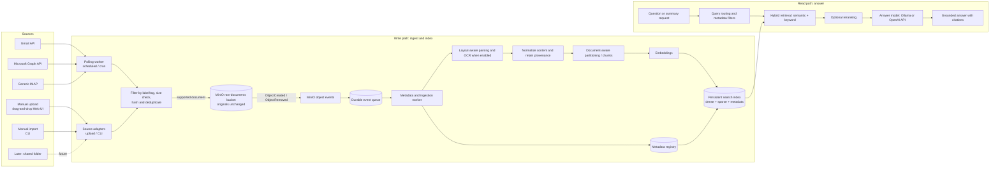
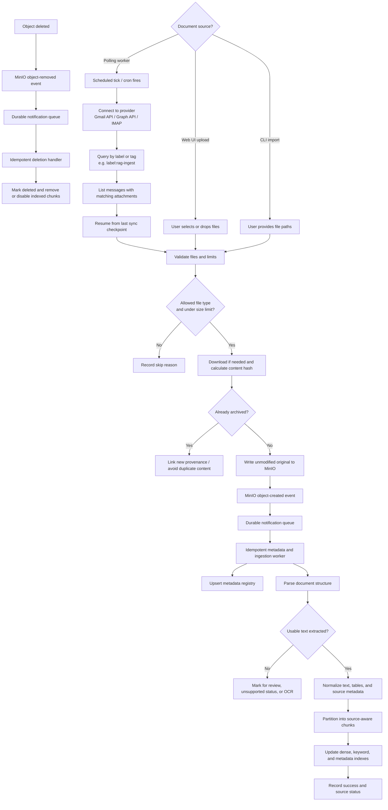
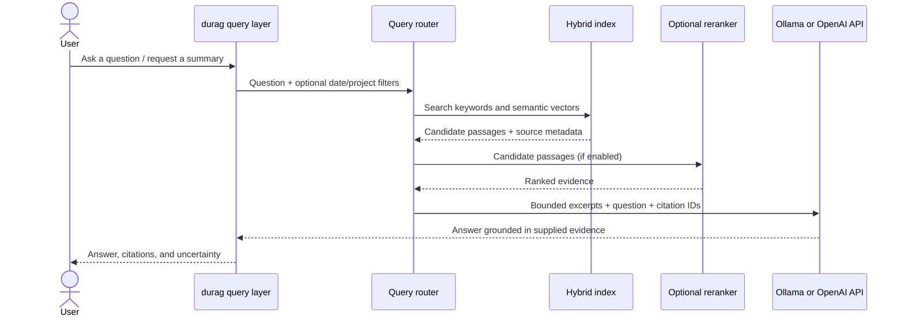

# Architecture

This document describes the intended architecture for durag. It is a design reference, not a claim that these components are already implemented.

## Core Architecture: Document Intake & Retrieval-Augmented Generation (RAG)

A standard long-context prompt window is insufficient for accumulating documents over months or years. The system requires a modular pipeline composed of four primary layers:

```
[Ingestion & ETL]  -->  [Chunking & Multi-Modal Parsing]  -->  [Storage & Vector Indexing]  -->  [Retrieval & Agentic LLM]
(PDF, DOCX, XLSX)      (Unstructured / LlamaParse)             (Qdrant/pgvector + BM25)          (Rerank -> Synthesis)
```

## Scope and boundaries

### Initial scope

- Single-user, self-hosted deployment; a **polling worker** handles scheduled email ingestion, with manual file upload as an additional intake path. MinIO is the durable object store for original documents.
- Manual upload via drag-and-drop in a Web UI and a CLI import path are both supported ingestion options in the design; the initial release may deliver these in phases.
- Gmail and Microsoft 365 connectors via a polling worker, implemented one at a time. Generic IMAP as a fallback for other providers.
- `.pdf`, `.docx`, and `.xlsx`; scanned PDFs/OCR and legacy `.doc` / `.xls` are follow-on capabilities.
- A configurable answer model: Ollama locally by default, with an optional OpenAI API model. "ChatGPT" means an OpenAI API model; ChatGPT web access does not include API usage, which is configured and billed separately.

### Explicitly out of scope for the first version

- Sending, moving, or deleting email; email bodies are not part of the knowledge corpus.
- General-purpose agents that can execute arbitrary tools, code, shell commands, or actions based on document content.
- Multi-user access control, public-facing deployment, and guaranteed extraction of every visual/table layout.
- Running spreadsheet macros or formulas. Excel analysis should be read-only and use extracted/cached values.

## End-to-end architecture

The system has two main paths: a **write path** for collecting and indexing documents, and a **read path** for retrieval and answer generation.



### Ingestion flow



The polling worker uses **label/tag-based filtering** to select which messages to process. Users tag or label messages for ingestion (e.g., `label:rag-ingest` in Gmail, a folder or category in Outlook) and the worker picks up matching attachments on each poll.

- Email provider permissions are **mailbox read permissions, not attachment-only permissions**. The worker applies its own file-type and label filters.
- Before granting access, review the consent screen and organizational policy; use a dedicated mailbox or a provider-supported folder/label restriction where appropriate.
- Do not persist email bodies. Keep only the provenance required for citations: provider, message ID, subject, sender, received date, and attachment filename.
- For manual uploads, record upload time, original filename, uploader identity (if applicable), and optional user-supplied tags; do not fabricate email metadata.
- Both email attachments and manual uploads use the same MinIO raw-document bucket and metadata/event processing path.

### Question and summary flow



## Design details

### 1. Email intake: polling worker

Email ingestion uses a **polling worker** — a scheduled background service (cron job or long-running process with a sleep interval) that connects to each configured email provider, queries for messages matching a user-defined label or tag, downloads qualifying attachments, and feeds them into the shared ingestion pipeline.

#### Provider adapters

| Provider | Library | Auth | Filter mechanism |
| --- | --- | --- | --- |
| Gmail | `google-api-python-client` | OAuth2 service account or user consent with `gmail.readonly` scope | Gmail label (e.g., `label:rag-ingest`) and search query `has:attachment filename:(pdf OR xlsx OR docx)` |
| Microsoft 365 / Outlook | `msal` + `requests` (Microsoft Graph API) | Delegated OAuth with `Mail.Read`; tenant consent may be required | Mail folder, category, or `$filter` OData query on `hasAttachments eq true` |
| Generic IMAP | Python `imaplib` + `email` (stdlib) | Username/password or app-specific password | IMAP `SEARCH` with keyword/flag criteria; folder selection |

#### Polling behavior

- The worker runs on a configurable schedule (e.g., every 15 minutes, hourly, or on-demand via CLI trigger).
- On each tick, connect to each enabled provider, query for messages matching the configured label/tag and attachment filters, and page through results.
- Start with a one-time historical backfill, then use provider history/delta cursors for incremental sync where practical. **Gmail** supports `historyId`-based incremental queries; **Microsoft Graph** supports delta queries. For IMAP, track the last-seen UID or message sequence.
- Persist checkpoints only after successfully handling each page/message; retry throttled or transient failures and provide a safe rescan path.
- Only download allowlisted file types. Validate actual content as well as extension, cap file size, handle pagination and provider throttling, and make individual attachment failures non-fatal to the whole sync.
- Compute SHA-256 for content identity. If the same binary appears in multiple messages, store the content once but retain each distinct email provenance reference.
- Never commit OAuth credentials, tokens, original documents, extracted text, or local index data to Git. Do not log secrets or document contents.

### 2. Manual document import

- Accept the same supported file types through two user-initiated paths: drag-and-drop/file selection in a Web UI, and an explicit CLI import of one or more file paths. Both paths call the same validation, MinIO upload, metadata, parser, provenance, and indexing pipeline used by email attachments.
- Store each accepted upload as an unmodified original in a dedicated MinIO bucket (proposed name: `durag-raw-documents`). Manual uploads land in this bucket; email attachments use it too so there is one canonical original-document store. Never parse in place or overwrite the original object; extracted text, previews, and other derived artifacts belong in metadata/index stores or a separate derived-data bucket.
- Use object keys with date and document-type prefixes, for example `originals/pdf/2026/10/17/<uuid>_incident-report.pdf`, `originals/docx/YYYY/MM/DD/...`, and `originals/xlsx/YYYY/MM/DD/...`. MinIO "folders" are key prefixes, not real directories. Use the UTC ingestion date (the day the object is added to the bucket) consistently for both manual uploads and email attachments; retain the email received date or other source date separately in metadata. Determine document type from validated content/MIME, not only the supplied extension.
- Configure notifications on the raw bucket for `ObjectCreated` and `ObjectRemoved` events, optionally scoped to the `originals/` prefix. The metadata/event worker consumes these notifications; it does not watch a filesystem directory. The Web UI and CLI should normally write through the ingestion service so each object has provenance and a pending metadata record. Keep the bucket private; if administrative or other direct object writes are allowed, the worker must reconcile them and mark missing provenance as unknown rather than inventing it.
- The Web UI and CLI submit files through the ingestion service, which validates limits and content and writes the original to MinIO. The service may use short-lived presigned uploads for large files, but only after creating a pending metadata record and applying size/type constraints. Do not expose MinIO credentials to browsers or end users.
- Upload/import is a document source in its own right, not a simulated email. Record source type (`manual_upload` or `cli_import`), upload/import timestamp, original filename, and optional user-supplied project/environment/tags. In a Web UI, record the authenticated user if authentication is enabled. Preserve email provenance separately for email-sourced copies.
- Enforce file count and size limits, extension allowlists, content/signature checks, safe generated storage names, and duplicate detection. Treat uploaded files as untrusted: do not execute content, macros, or embedded actions. Consider malware scanning before making originals available to parsers or users.
- A repeated upload of identical content should not create duplicate indexed content, but it may add a new provenance record. Show per-file status (accepted, duplicate, indexed, needs review, or rejected) and a clear reason for failures.
- Drag-and-drop is a Web UI capability; CLI import remains useful for scripts, batch loads, and headless servers. Keep the first UI decision open, but design both as thin clients of one ingestion service.

### 3. Parsing and document-aware partitioning

Parsing is a critical quality boundary: poor extraction produces poor retrieval regardless of the language model. Keep the parser replaceable and evaluate it against representative documents before choosing a production dependency.

| Format | Extraction and partitioning strategy | Source context to retain |
| --- | --- | --- |
| PDF | Preserve page boundaries, headings, lists, footnotes, and tables where possible. Detect image-only pages; flag them or route them through an optional OCR stage. | Filename, page number, detected heading, source type and provenance |
| DOCX | Preserve heading hierarchy, paragraphs, lists, and tables; avoid flattening unrelated sections together. | Filename, heading/section, table context, source type and provenance |
| XLSX | Process each sheet independently. Capture sheet name, column names/schema, row context, and data types; serialize rows/tables as readable Markdown or structured records. | Filename, sheet, table/row range, column headers, source type and provenance |

Tools worth evaluating include **Docling** and **Unstructured** for self-hostable structured parsing, and **LlamaParse** for a managed parsing option. Compare quality, deployment/runtime cost, licensing, file handling, and whether document content leaves the environment. Avoid binding the architecture to one parser before testing.

For spreadsheets, do not embed a massive sheet as one undifferentiated text block. Keep rows or coherent table sections addressable, preserve headers and units, and use a deterministic table/SQL/Pandas-style query path for numeric questions. Any future code execution must be isolated, read-only, resource-limited, and explicitly designed; do not give a document-driven agent unrestricted shell or network access.

Use overlapping, structure-aware chunks rather than arbitrary fixed-size splits. Attach metadata to every chunk, including document ID, original filename, file type, source type, source email or upload provenance, received/uploaded/ingested dates, page/sheet/section, and optional project/environment labels. Empty, encrypted, malformed, or low-confidence extraction should produce an observable status for review.

### 4. Long-term storage and indexing

- **Original archive is authoritative.** Use a dedicated MinIO bucket for unmodified source files. Organize object keys by document type and date (day), with generated unique IDs to avoid collisions and unsafe filenames. Back up the bucket and metadata database independently of the search index.
- **Event-driven metadata registry.** Configure MinIO bucket notifications for object-created and object-removed events, delivered to a durable queue or authenticated event service. A metadata worker consumes events and maintains a registry of object key/version, event ID, content hash, detected type, size, source/provenance, timestamps, tags, and processing/index status. Object-created events enqueue validation/parsing/indexing; object-removed events mark the record deleted and remove or disable its indexed chunks according to retention policy.
- **Events are triggers, not the only source of truth.** Notifications can be retried, duplicated, delayed, or missed during outages. Make event handling idempotent, verify object existence/version before processing, retry failures, and periodically reconcile the bucket inventory against the metadata registry. Use a durable queue with dead-letter handling where available. Never rely on a process watching a local "folder" for MinIO changes.
- **Deletion and immutability.** The ingestion path never overwrites originals. Use unique object keys and consider MinIO bucket versioning; apply object-lock/retention only if the data-retention policy requires it. Route user deletions through durag so the registry, object store, and search index stay consistent. External deletion is detected through MinIO events and reconciliation. Document how versioned deletes, backups, and retention affect permanent erasure.
- **Index is derived and rebuildable.** Store extracted content/metadata needed to reproduce indexing. Pin parser and embedding model versions and record them with index metadata; re-embed deliberately when changing embedding models.
- **Hybrid search:** combine dense semantic vectors with sparse/keyword search such as BM25. Exact terms matter for DevOps material (error strings, resource names, hashes, and version identifiers), while vector search helps find conceptually related passages.
- Use a relational metadata registry (PostgreSQL is the proposed choice) for object lifecycle, provenance, processing state, tags, and event deduplication. Keep this separate conceptually from the vector/search index even if they share a PostgreSQL deployment.
- Candidate search stores to evaluate: **PostgreSQL + pgvector** when a relational source of metadata and fewer services are preferred; **Qdrant** for a dedicated vector service and payload filtering. For production hybrid search, verify the chosen backend's sparse/BM25 support and operational behavior rather than assuming a vector database alone supplies every search mode.
- Use metadata filters for time range, document type, provider, project, environment, and source as the corpus grows. Do not infer project/environment tags silently; distinguish extracted facts from user-supplied labels.
- Add a cross-encoder reranker only after measuring retrieval quality and latency. Local rerankers avoid another external document processor; hosted rerankers require the same data-sharing review as hosted LLMs.

### 5. Retrieval, routing, and synthesis

- Keep ingestion, retrieval, and answer generation behind replaceable interfaces. **LlamaIndex** is a candidate orchestration/indexing framework for a custom pipeline, not a requirement; a small initial implementation can start without a workflow engine.
- Route narrative questions to hybrid document retrieval. Route well-scoped spreadsheet aggregation questions to a safe structured-data path. For questions spanning both, combine results and cite each source independently.
- For long incident reports, policies, and SLAs, use hierarchical summarization: summarize sections or chunks first, then synthesize a document-level summary from those grounded summaries. Retain links to underlying source passages so summary citations can be checked.
- Start with bounded retrieval and synthesis. Add agentic/multi-step behavior only for defined workflows, with explicit limits and evaluation; do not treat "agentic" as permission for arbitrary actions.
- The answer backend is configurable. Ollama can keep answer generation local. An optional OpenAI API model can receive the question and only the selected excerpts; it does not need the full archive. This sends potentially sensitive text to OpenAI and must be explicitly approved for the data. API access and billing are separate from a ChatGPT web subscription. Keep API credentials in a secret manager or local environment configuration, never Git or logs.
- Regardless of model, instruct it to answer from supplied evidence, state when evidence is missing or conflicting, and cite stable source IDs. The UI/CLI should resolve each citation to filename, page/sheet/section, source type, and relevant provenance (email subject/date or upload date/uploader).
- Treat every document and retrieved passage as untrusted data, not executable instructions. Limit context size, prevent retrieved text from invoking tools, and test for prompt-injection attempts.

## Build or deploy?

There are two reasonable ways to get value from this project. They are alternatives, not components that must all be adopted.

| Path | Examples | Strengths | Trade-offs |
| --- | --- | --- | --- |
| Turnkey knowledge platform | AnythingLLM, Dify, Open WebUI | Fast UI and document Q&A; may connect to local or hosted models | Verify drag-and-drop/manual import, email attachment automation, source citations, Excel analysis, access controls, and persistence against requirements |
| Custom, self-hosted pipeline | LlamaIndex with Docling/Unstructured, PostgreSQL + pgvector or Qdrant, local or API models | Control over manual uploads, email sync, parsing, metadata, hybrid retrieval, and DevOps-specific workflows | More code, testing, upgrades, and operations |
| Managed cloud/enterprise search | Azure AI Search / Azure AI services, AWS Bedrock-based architecture | Managed operations and integration with existing cloud governance | Cloud configuration and cost; document data is processed within the chosen provider boundary and must meet policy |

**Recommendation for durag:** build the custom pipeline in small steps because multiple-source provenance, idempotent long-term intake, and spreadsheet-aware DevOps queries are central requirements. Deploy on a local Kubernetes cluster, fully packaged and configured via a unified Helm chart (`charts/durag`). Use **MinIO for unmodified originals**, **PostgreSQL for metadata and lifecycle/event state**, and evaluate **PostgreSQL + pgvector versus Qdrant** for search. Use **LlamaIndex as an optional orchestration layer** and evaluate **Docling first for a local parser**. Begin with a CLI for reliable batch import and a simple service/API boundary that can later power drag-and-drop in a Web UI. Configure MinIO events to a durable queue or event service, with retries and reconciliation; do not introduce Airflow or Temporal for a single-user manual-sync MVP. Adopt a workflow engine only if retries, parallelism, or multiple sources justify it.

For immediate productivity before building, pilot a turnkey platform with a non-sensitive sample set and verify it can meet the same privacy, citation, Excel, manual upload, email-sync, backup, and deletion requirements.

## Security, reliability, and operations

- Keep OAuth scopes read-only and as narrow as provider capabilities allow. Tokens belong in permission-restricted storage or a secrets manager.
- Treat MinIO originals and the metadata registry as sensitive. Define network isolation, authentication/authorization, TLS, encryption at rest, encrypted backups, retention, and deletion behavior before importing regulated or confidential documents. Use separate least-privilege MinIO service accounts for upload, event processing, and administration.
- Preserve provenance and sync status. Track counts, checkpoints, object events, processing state, errors, and skip reasons without logging raw attachment contents or secrets.
- Make ingestion resumable, idempotent, and observable. A failed parse or index update must be retryable without losing the original.
- Provide a deletion operation that removes the indexed chunks, extracted content, and archived original according to retention policy; account for backups and duplicate provenance.
- Test MinIO and metadata-database backup restoration, event replay/reconciliation, and index rebuilding. The vector index must never be the only copy of the documents.
- Evaluate with representative PDFs, Word docs, and spreadsheets. Measure extraction coverage, retrieval relevance, citation correctness, hallucination/abstention behavior, and latency before calling the pipeline production-ready.

## Suggested delivery plan

1. **Agree design and data policy:** choose first email provider, whether CLI import or Web UI upload comes first, MinIO deployment/bucket policy, metadata database, local-vs-hosted model policy, and retention/backup requirements.
2. **Storage and ingestion foundation:** provision MinIO and the raw-document bucket, define type/date object keys and event notifications, then implement the shared ingestion service, starting with CLI import and/or one email provider; add manual Web UI upload, validation, hash deduplication, provenance, retries, metadata status, and reconciliation.
3. **Parsing and local retrieval:** test parser quality; extract PDF/DOCX/XLSX structure; add versioned embeddings, persistent metadata, and hybrid retrieval; establish an evaluation corpus using both uploaded and email-sourced documents.
4. **Grounded Q&A and summaries:** add citations, uncertainty handling, hierarchical summaries, and configurable Ollama/OpenAI API answer generation with explicit data-sharing controls.
5. **Production operations:** add the second email provider, deletion/retention controls, backup/restore, monitoring, optional reranking, scheduled sync, and OCR/structured spreadsheet querying as requirements demand.

→ For the detailed, step-by-step implementation plan and Helm packaging architecture across 9 phases, see [docs/wbs.md](wbs.md).

## Contributors

- [Cedric KOUEKAM](https://github.com/CedricElie)
- [Guylaine NGOUDJO](https://github.com/ngoug)
