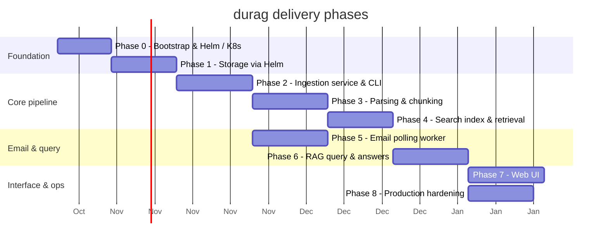

# Work Breakdown Structure (WBS)

Detailed project plan for delivering durag as a usable system deployed on a local Kubernetes cluster.

Each phase produces a working, testable increment. Later phases depend on earlier ones but tasks within a phase can often run in parallel.

---

## Phase 0 — Project bootstrap, local Kubernetes environment, and Helm scaffolding

Set up the development environment, repository structure, local K8s cluster, and the primary Helm chart (`charts/durag`) before writing application code. All Kubernetes resources must be defined and packaged via Helm from day one.

| ID | Task | Deliverable | Depends on |
|---|---|---|---|
| 0.1 | Provision local Kubernetes cluster (k3s, minikube, or kind) | Running cluster with `kubectl` access | — |
| 0.2 | Scaffold primary `durag` Helm chart (`charts/durag`) with `Chart.yaml`, base `values.yaml`, `templates/_helpers.tpl`, `.helmignore`, and linting CI | Buildable, lintable Helm chart structure | 0.1 |
| 0.3 | Set up container registry (local or private) | Registry accessible from cluster and Helm image values | 0.1 |
| 0.4 | Configure Helm release namespace and resource quotas in chart templates/values | `durag` namespace with quota manifests managed via Helm | 0.2 |
| 0.5 | Set up Python project structure (`pyproject.toml`, linting, tests) | Buildable Python package in `src/durag/` | — |
| 0.6 | Create base multi-stage `Dockerfile` for durag services | Image tag strategy aligned with Helm `image.tag` values | 0.5 |
| 0.7 | Set up CI pipeline (build, lint, test, image push, `helm lint`) | Green pipeline verifying Docker builds and Helm chart validity | 0.2, 0.6 |
| 0.8 | Define Kubernetes secret management strategy for Helm (Sealed Secrets, SOPS/helm-secrets, or external-secrets) | Secrets workflow integrated with Helm values and documented | 0.2 |
| 0.9 | Agree data policy: retention, backup targets, encryption-at-rest, model hosting | Signed-off policy document | — |

**Exit criteria:** `helm lint charts/durag` passes; base chart installs via `helm upgrade --install durag ./charts/durag --namespace durag --create-namespace`; secrets and namespace quotas are managed declaratively.

---

## Phase 1 — Storage infrastructure on Kubernetes via Helm

Deploy stateful backing services as Helm dependencies/subcharts under `charts/durag`.

| ID | Task | Deliverable | Depends on |
|---|---|---|---|
| 1.1 | Add MinIO as a Helm chart dependency in `Chart.yaml` with values for persistence and single/multi-node | MinIO deployed via `helm dependency update` with PVC storage | 0.1, 0.2 |
| 1.2 | Create `durag-raw-documents` bucket and bucket policy via Helm post-install hook or MinIO provisioning Job | Bucket automatically provisioned upon Helm install | 1.1 |
| 1.3 | Configure MinIO bucket notifications (`ObjectCreated`, `ObjectRemoved`) via Helm values/job | Events flowing to queue endpoint | 1.2 |
| 1.4 | Add PostgreSQL with pgvector as a Helm chart dependency (Bitnami or CloudNativePG) with PV storage | PostgreSQL running with vector extension via Helm | 0.1, 0.2 |
| 1.5 | Create metadata registry schema migrations (packaged as a Helm pre-upgrade/install migration Job) | Database schema and tables automatically initialized via Helm | 1.4 |
| 1.6 | Verify pgvector indexing and vector extension in PostgreSQL Helm deployment | Vector search queries operational in cluster | 1.4, 1.5 |
| 1.7 | Add durable event queue (Redis Streams or NATS) as a Helm chart dependency | Queue deployed and connected via Helm release | 0.2, 1.3 |
| 1.8 | Manage MinIO and PostgreSQL service accounts and credentials via Helm-managed K8s Secrets | Least-privilege credentials templated in Helm | 1.1, 0.8 |
| 1.9 | Package backup CronJobs into Helm chart templates (MinIO mirror + pg_dump to backup PVC) | Automated daily backups deployed via `charts/durag/templates/backup-cronjobs.yaml` | 1.1, 1.4 |

**Exit criteria:** Running `helm upgrade --install durag ./charts/durag` provisions MinIO, PostgreSQL, and the event queue; schema migrations run via Helm hook; backups are scheduled.

---

## Phase 2 — Core ingestion service and CLI import

## Phase 2 — Core ingestion service and CLI import

Build the shared ingestion pipeline that every document source (CLI, Web UI, polling worker) uses, packaged into the `durag` Helm chart.

| ID | Task | Deliverable | Depends on |
|---|---|---|---|
| 2.1 | Implement ingestion service: validate file type, size, content signature | Python module with accept/reject logic | 0.5 |
| 2.2 | Implement SHA-256 content hashing and deduplication check against metadata registry | Duplicate detection working | 2.1, 1.5 |
| 2.3 | Implement MinIO upload: generate object key (`originals/<type>/YYYY/MM/DD/<uuid>_<safe-name>`) | Objects stored with correct key structure | 2.1, 1.2 |
| 2.4 | Record provenance and pending metadata in PostgreSQL on upload | Metadata row created before object write completes | 2.3, 1.5 |
| 2.5 | Implement CLI import command (`durag import <file> [--tags ...]`) | Working CLI that imports files end-to-end | 2.1–2.4 |
| 2.6 | Implement event consumer: listen to MinIO object events from the durable queue | Worker receives and acknowledges events | 1.7 |
| 2.7 | Make event consumer idempotent: check object existence/version, deduplicate event IDs | Safe to replay events | 2.6, 1.5 |
| 2.8 | Implement per-file status reporting (accepted, duplicate, rejected, reason) | CLI shows clear status per file | 2.5 |
| 2.9 | Write integration tests: import → MinIO → event → metadata row | Tests pass against K8s-deployed services | 2.1–2.7 |
| 2.10 | Package Ingestion Service into Helm chart (`templates/ingestion-deployment.yaml`, `service.yaml`) | Service deployable and configurable via Helm values | 2.9, 0.2, 0.6 |
| 2.11 | Package Event Consumer Worker into Helm chart (`templates/event-consumer-deployment.yaml`) | Worker pod processing queue deployed via Helm | 2.10, 0.2 |

**Exit criteria:** `durag import report.pdf` stores the original in MinIO, creates a metadata record, and the Helm-deployed event worker picks up the event.

---

## Phase 3 — Document parsing and chunking

Extract structured content from documents and partition into searchable chunks, managed within the Helm-packaged worker environment.

| ID | Task | Deliverable | Depends on |
|---|---|---|---|
| 3.1 | Evaluate Docling vs. Unstructured vs. LlamaParse against representative test documents | Comparison report with quality scores | 0.9 |
| 3.2 | Implement parser interface (abstract adapter pattern) | Swappable parser behind a common API | 0.5 |
| 3.3 | Implement chosen parser adapter (Docling first) for PDF | PDF → structured elements with page/heading metadata | 3.1, 3.2 |
| 3.4 | Implement parser adapter for DOCX | DOCX → structured elements with heading/section metadata | 3.2 |
| 3.5 | Implement parser adapter for XLSX | XLSX → per-sheet table records with headers and row ranges | 3.2 |
| 3.6 | Implement quality gate: detect empty, encrypted, or low-confidence extraction | Documents flagged as `needs_review` | 3.3–3.5 |
| 3.7 | Implement structure-aware chunking with overlap and metadata attachment | Chunks with document_id, page, section, provenance, dates | 3.3–3.5 |
| 3.8 | Wire parser + chunker into the event consumer worker | Event → parse → chunk pipeline working end-to-end | 2.6, 3.7 |
| 3.9 | Configure parser runtime dependencies / sidecar in worker Helm template and values | Parser runtime resource allocations and models configured via Helm | 3.3, 0.2, 0.6 |
| 3.10 | Write parser quality tests against the evaluation corpus | Tests assert minimum extraction coverage | 3.8 |

**Exit criteria:** Importing a PDF/DOCX/XLSX produces metadata-rich chunks stored in the registry; low-quality documents are flagged; worker runs seamlessly via Helm release.

---

## Phase 4 — Search index and hybrid retrieval

Build the searchable index that powers the read path, packaged and configured via Helm.

| ID | Task | Deliverable | Depends on |
|---|---|---|---|
| 4.1 | Choose and pin embedding model (e.g., `sentence-transformers` or Ollama embeddings) | Model version recorded in config | 0.9 |
| 4.2 | Implement embedding generation for chunks | Dense vectors produced per chunk | 4.1, 3.7 |
| 4.3 | Store embeddings in pgvector (or Qdrant) with chunk metadata as payload | Vectors indexed and queryable | 4.2, 1.6 |
| 4.4 | Implement BM25 / sparse keyword index (pg `tsvector` or Qdrant sparse vectors) | Keyword search working | 3.7, 1.4 or 1.6 |
| 4.5 | Implement hybrid retrieval: combine dense + sparse scores | Fused ranked results from both indexes | 4.3, 4.4 |
| 4.6 | Add metadata filters (date range, document type, source, project/tags) | Filtered queries return correct subsets | 4.5 |
| 4.7 | Wire embedding + indexing into the event consumer (parse → chunk → embed → index) | Full write path operational | 4.3, 3.8 |
| 4.8 | Implement index rebuild command (`durag reindex`) from archived originals | Full reindex completes without data loss | 4.7, 2.3 |
| 4.9 | Package embedding model service into Helm chart (`templates/embedding-deployment.yaml` or Ollama subchart) | Embedding model deployed via Helm with GPU/CPU node affinity values | 4.1, 0.2, 0.6 |
| 4.10 | Write retrieval quality tests: known queries → expected documents in top-k | Baseline recall/precision measured | 4.5 |

**Exit criteria:** Imported documents are automatically embedded and indexed; hybrid search returns relevant passages for test queries in the Helm-deployed stack.

---

## Phase 5 — Email polling worker

Implement the scheduled email ingestion service, packaged as a configurable Helm template.

| ID | Task | Deliverable | Depends on |
|---|---|---|---|
| 5.1 | Implement provider adapter interface | Common API for all email providers | 0.5 |
| 5.2 | Implement Gmail adapter (`google-api-python-client`, `gmail.readonly`, label filter) | Gmail polling functional against test mailbox | 5.1 |
| 5.3 | Implement Microsoft Graph adapter (`msal` + `requests`, `Mail.Read`, folder/category filter) | Graph polling functional against test mailbox | 5.1 |
| 5.4 | Implement generic IMAP adapter (`imaplib` + `email`, folder + SEARCH filter) | IMAP polling functional | 5.1 |
| 5.5 | Implement checkpoint persistence (historyId / deltaLink / IMAP UID) in PostgreSQL | Incremental sync resumes from last position | 5.2–5.4, 1.5 |
| 5.6 | Implement historical backfill mode (full scan, then switch to incremental) | One-time backfill completes and transitions | 5.5 |
| 5.7 | Wire attachment downloads into the shared ingestion pipeline (validate → hash → MinIO → event) | Email attachments indexed like CLI imports | 5.2–5.4, 2.1–2.4 |
| 5.8 | Record email provenance (provider, message_id, subject, sender, received_date, filename) | Provenance rows in metadata registry | 5.7 |
| 5.9 | Handle throttling, pagination, transient failures, and non-fatal per-attachment errors | Robust polling under provider limits | 5.7 |
| 5.10 | Implement configurable schedule (cron expression or sleep interval) | Schedule settable via config/env | 5.7 |
| 5.11 | Implement on-demand CLI trigger (`durag poll --provider gmail --now`) | Manual poll for testing/debugging | 5.10 |
| 5.12 | Manage OAuth credentials and email secrets in Helm templates (`templates/secrets.yaml` or external-secrets) | Secure credential handling integrated with Helm values | 0.8 |
| 5.13 | Package polling worker into Helm chart (`templates/polling-worker.yaml`, toggleable as CronJob or Deployment) | Scheduled worker pod deployed and managed via Helm values | 5.10, 0.2, 0.6 |
| 5.14 | Write integration tests against a test mailbox with known attachments | Tests verify end-to-end email → index | 5.7 |

**Exit criteria:** The polling worker runs on schedule via Helm deployment, picks up labeled email attachments, and they appear in the search index with correct provenance.

---

## Phase 6 — RAG query layer and answer generation

Build the read path: question → retrieval → LLM → cited answer, packaged as Helm services.

| ID | Task | Deliverable | Depends on |
|---|---|---|---|
| 6.1 | Integrate Ollama as a Helm chart dependency/subchart with configurable model-pulling initContainer | Ollama running and managed via `durag` Helm release | 0.1, 0.2 |
| 6.2 | Implement query router: classify question type (narrative vs. structured/spreadsheet) | Router returns query plan | 4.5 |
| 6.3 | Implement retrieval pipeline: query → hybrid search → candidate passages | Ranked passages with source metadata | 4.5, 6.2 |
| 6.4 | Implement optional cross-encoder reranker (add only after baseline measurement) | Reranker improves top-k precision | 6.3 |
| 6.5 | Implement answer synthesis: bounded excerpts + question → Ollama (or OpenAI API) | Grounded answer from supplied evidence | 6.1, 6.3 |
| 6.6 | Implement citation generation: stable source IDs resolved to filename, page, provenance | Each answer statement has a traceable citation | 6.5, 1.5 |
| 6.7 | Implement uncertainty handling: model states when evidence is missing or conflicting | Explicit abstention in answers | 6.5 |
| 6.8 | Implement hierarchical summarization for long documents | Section summaries → document summary with citations | 6.5 |
| 6.9 | Add optional OpenAI API backend (configurable via Helm values, explicit data-sharing approval required) | Switchable answer model configured via Helm | 6.5, 0.8 |
| 6.10 | Implement CLI query command (`durag ask "question" [--filters ...]`) | CLI returns answer with citations | 6.5, 6.6 |
| 6.11 | Implement prompt-injection defenses: context size limits, input sanitization | Retrieved text cannot invoke tools | 6.5 |
| 6.12 | Package Query Service into Helm chart (`templates/query-deployment.yaml`, `query-service.yaml`) | Query API accessible within cluster via Helm service | 6.10, 0.2, 0.6 |
| 6.13 | Write answer quality tests: known questions → expected citations, abstention on unknowns | Baseline quality measured | 6.10 |

**Exit criteria:** `durag ask "What was the root cause in the October incident report?"` returns a grounded answer citing the correct document, page, and source via the Helm-managed query stack.

---

## Phase 7 — Web UI

Build the user-facing interface for document upload and question answering, packaged into the `durag` Helm chart.

| ID | Task | Deliverable | Depends on |
|---|---|---|---|
| 7.1 | Choose frontend framework and set up project (e.g., Next.js or Vite + React) | Buildable frontend project | — |
| 7.2 | Implement drag-and-drop / file-selection upload UI | Files submitted to ingestion service API | 2.10, 7.1 |
| 7.3 | Show per-file upload status (accepted, duplicate, indexing, needs review, rejected) | Real-time status feedback | 7.2, 2.8 |
| 7.4 | Implement question/answer interface | User types question → sees grounded answer with citations | 6.12, 7.1 |
| 7.5 | Render citations as clickable links resolved to filename, page/sheet, source, and date | Citations navigable | 7.4 |
| 7.6 | Add metadata filter controls (date range, document type, source, tags) | Filtered queries from the UI | 7.4, 4.6 |
| 7.7 | Implement document browser: list indexed documents, status, provenance | Overview of the knowledge base | 1.5, 7.1 |
| 7.8 | Implement polling worker status dashboard (last run, documents processed, errors) | Operational visibility | 5.13, 7.1 |
| 7.9 | Build and containerize frontend | Docker image for the Web UI | 7.1–7.8 |
| 7.10 | Package Web UI into Helm chart (`templates/ui-deployment.yaml`, `ui-service.yaml`, `ingress.yaml`) | UI accessible from browser via Helm-configured Ingress/Service | 7.9, 0.2, 0.6 |

**Exit criteria:** A user can open the UI deployed via Helm, upload a document, wait for indexing, ask a question, and receive a cited answer.

---

## Phase 8 — Production hardening and operations

Make the system reliable, secure, and maintainable for long-term use through Helm chart configurations and Day-2 operations.

| ID | Task | Deliverable | Depends on |
|---|---|---|---|
| 8.1 | Implement deletion operation (remove indexed chunks, extracted content, and original per retention policy) | Delete propagates across MinIO, PG, and index | 2.10, 4.7 |
| 8.2 | Package bucket reconciliation into Helm chart templates (`templates/reconciliation-cronjob.yaml`) | Automated cron job detecting inventory drift | 1.5, 1.2, 0.2 |
| 8.3 | Add structured logging (JSON) across all services | Logs queryable; no secrets or document content logged | All services |
| 8.4 | Integrate Prometheus & Grafana monitoring via Helm (`ServiceMonitor` templates and subchart values) | Helm values enable dashboards for ingestion, queue depth, retrieval latency | 0.2 |
| 8.5 | Standardize health checks, readiness, and liveness probes across all Helm deployment templates | K8s automatically restarts unhealthy pods | All deployments |
| 8.6 | Implement backup restoration test (MinIO + PostgreSQL) as a runbook and automated test | Documented and tested restore procedure | 1.9 |
| 8.7 | Package NetworkPolicies and PodDisruptionBudgets in Helm chart (`templates/networkpolicies.yaml`) | In-cluster traffic isolated; pod availability safeguarded | 0.2 |
| 8.8 | Parameterize all CPU/memory requests and limits across `values.yaml` and `values-prod.yaml` | Workloads resource-bounded and predictable | All deployments |
| 8.9 | Implement dead-letter handling for failed events | Failed events visible and retryable | 1.7, 2.6 |
| 8.10 | Run end-to-end evaluation: extraction coverage, retrieval relevance, citation correctness, latency | Quality report against representative corpus | 3.10, 4.10, 6.13 |
| 8.11 | Write operational runbook for Helm lifecycle: install, values profiles, upgrades, rollback, secret rotation | Runbook in `docs/` covering `helm upgrade`, `helm rollback`, and chart versioning | All |

**Exit criteria:** The complete system is deployed and upgraded solely via `helm upgrade --install`, handles pod restarts and retries gracefully, and has working monitoring and backup restoration.

---

## Phase summary



> **Note:** Phase 5 (polling worker) can run in parallel with Phases 3–4 since it feeds into the same ingestion pipeline. Phase 7 (Web UI) and Phase 8 (hardening) can also overlap.

---

## Helm chart architecture and packaging

All Kubernetes workloads and infrastructure are packaged and managed through a single primary Helm chart: `charts/durag`.

```
charts/durag/
├── Chart.yaml                  # Chart metadata, versioning, subchart dependencies
├── values.yaml                 # Base default values and component toggle flags
├── values-local.yaml           # Local environment overrides (k3s/kind, local storage, NodePort)
├── values-prod.yaml            # Production overrides (HA replicas, PVC storage classes, TLS Ingress)
├── templates/
│   ├── _helpers.tpl            # Standard labels, naming helpers, and selector definitions
│   ├── namespace.yaml          # durag namespace and ResourceQuota definitions
│   ├── secrets.yaml            # K8s Secret references / integration with secret provider
│   ├── configmap.yaml          # Shared cluster configuration and environment variables
│   ├── ingestion-deployment.yaml # Ingestion Service Deployment & HPA
│   ├── ingestion-service.yaml    # Ingestion ClusterIP Service
│   ├── consumer-deployment.yaml  # Event Consumer Worker Deployment
│   ├── polling-worker.yaml     # Polling Worker (configurable as CronJob or Deployment)
│   ├── query-deployment.yaml   # Query Service Deployment & HPA
│   ├── query-service.yaml      # Query Service ClusterIP
│   ├── ui-deployment.yaml      # Web UI Deployment
│   ├── ui-service.yaml         # Web UI Service
│   ├── ingress.yaml            # Ingress controller routing (Web UI & Ingestion API)
│   ├── embedding-deployment.yaml # Optional dedicated embedding model Deployment
│   ├── backup-cronjobs.yaml    # Scheduled MinIO mirror and PostgreSQL pg_dump CronJobs
│   ├── reconciliation-cronjob.yaml # Bucket ↔ registry consistency checker CronJob
│   ├── networkpolicies.yaml    # Pod-to-pod network isolation rules
│   └── servicemonitors.yaml    # Prometheus Operator ServiceMonitors & alerts
```

### Dependency management (`Chart.yaml`)

Third-party backing services are managed as Helm subcharts/dependencies in `Chart.yaml`:
- **MinIO:** `minio/minio` (object storage with PVCs and bucket notification config)
- **PostgreSQL / pgvector:** `bitnami/postgresql` or CloudNativePG operator (metadata DB with pgvector extension)
- **Event Queue:** `bitnami/redis` (Redis Streams) or `nats/nats` (JetStream)
- **Ollama (Local LLM / Embeddings):** `ollama/ollama` (optional local inference engine with PVC model cache)
- **Monitoring (optional dev profile):** `prometheus-community/kube-prometheus-stack`

### Packaging & deployment commands

```bash
# Update and download subchart dependencies
helm dependency update ./charts/durag

# Lint chart syntax and template validity
helm lint ./charts/durag -f ./charts/durag/values-local.yaml

# Dry-run template generation
helm template durag ./charts/durag -f ./charts/durag/values-local.yaml --debug

# Install or upgrade on local Kubernetes (k3s / kind / minikube)
helm upgrade --install durag ./charts/durag \
  --namespace durag \
  --create-namespace \
  -f ./charts/durag/values-local.yaml

# Package for distribution / artifact registry
helm package ./charts/durag --destination ./dist/
```

---

## Kubernetes resource map (Helm packaged)

Summary of all workloads deployed to the `durag` namespace, mapped directly to their Helm packaging source.

| Resource | K8s kind | Helm Packaging Source | Phase | Notes |
|---|---|---|---|---|
| MinIO | StatefulSet / Service | Dependency: `minio/minio` | 1 | PVC-backed; bucket notifications enabled |
| PostgreSQL | StatefulSet / Service | Dependency: `bitnami/postgresql` | 1 | pgvector extension enabled; PVC-backed |
| Event queue | StatefulSet or Deployment | Dependency: `bitnami/redis` (or NATS) | 1 | Durable stream for MinIO bucket events |
| Ingestion service | Deployment + Service | `charts/durag/templates/ingestion-*.yaml` | 2 | Shared API for CLI, Web UI, and polling worker |
| Event consumer worker | Deployment | `charts/durag/templates/consumer-deployment.yaml` | 2 | Processes MinIO events → parse → chunk → index |
| Embedding model | Deployment + Service | `charts/durag/templates/embedding-*.yaml` (or Ollama subchart) | 4 | CPU / GPU node affinity via `values.yaml` |
| Polling worker | CronJob or Deployment | `charts/durag/templates/polling-worker.yaml` | 5 | Scheduled email ingestion, toggled via values |
| Query service | Deployment + Service | `charts/durag/templates/query-*.yaml` | 6 | REST/gRPC API for grounded Q&A |
| Ollama (LLM engine) | Deployment + Service | Dependency: `ollama/ollama` | 6 | Local model serving with PVC model cache |
| Web UI | Deployment + Service | `charts/durag/templates/ui-*.yaml` | 7 | Ingress or NodePort for browser access |
| Ingress | Ingress | `charts/durag/templates/ingress.yaml` | 7 | Single entrypoint routing to UI and Ingestion API |
| Backup jobs | CronJob | `charts/durag/templates/backup-cronjobs.yaml` | 1, 8 | MinIO + PostgreSQL backups to local/remote PV |
| Reconciliation job | CronJob | `charts/durag/templates/reconciliation-cronjob.yaml` | 8 | Periodic MinIO inventory ↔ metadata audit |
| Network isolation | NetworkPolicy | `charts/durag/templates/networkpolicies.yaml` | 8 | Intra-namespace zero-trust network boundaries |
| Monitoring | ServiceMonitor | `charts/durag/templates/servicemonitors.yaml` | 8 | Prometheus metrics scraping and alerting |

---

## Contributors

- [Cedric KOUEKAM](https://github.com/CedricElie)
- [Guylaine NGOUDJO](https://github.com/ngoug)

